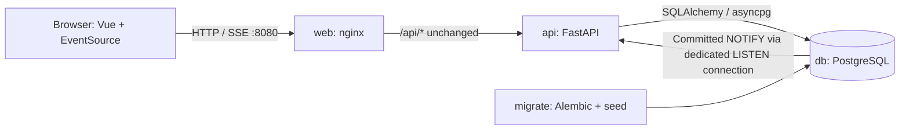

# Architecture

[README](../README.md) · [API](api.md) · [Contributing](../CONTRIBUTING.md) · [Operations](operations.md)

## Runtime layout

Compose waits for PostgreSQL, runs `migrate` to completion, then starts the API and web service. Only nginx publishes a port. For host development, Vite replaces nginx and proxies `/api` to port 8000; `make dev-db` publishes PostgreSQL on loopback port 5432.

## Code boundaries

| Location                                                                       | Responsibility                                                  |
| ------------------------------------------------------------------------------ | --------------------------------------------------------------- |
| [main.py](../backend/app/main.py)                                              | App lifecycle and domain-error mapping                          |
| [routes.py](../backend/app/routes.py), [schemas.py](../backend/app/schemas.py) | Input validation, service calls, and responses                  |
| [services/](../backend/app/services/)                                          | Queries and transactions; the only runtime writer of `reserved` |
| [models.py](../backend/app/models.py), [migrations/](../backend/migrations/)   | Data model and schema                                           |
| [events.py](../backend/app/events.py)                                          | PostgreSQL listener and subscriber queues                       |
| [useWorkshops.ts](../frontend/src/composables/useWorkshops.ts)                 | List loading, submissions, and live counts                      |
| [components/](../frontend/src/components/), [api/](../frontend/src/api/)       | Forms/display and shared HTTP client/types                      |

The frontend keeps server state in Vue refs. Booking emails stay in tab memory and disappear on refresh. “You're booked” reflects only that tab and never hides Reserve.

## Data model

A workshop has a unique slug, title, start time, capacity, and reserved counter. A reservation stores its workshop, name, email, active/cancelled status, and timestamps. Cancellation retains the row.

Two database safeguards enforce the limits:

- `CHECK (reserved BETWEEN 0 AND capacity)` bounds the counter.
- A unique index on `(workshop_id, lower(email)) WHERE status = 'active'` prevents duplicate active seats.

The API exposes `remaining = capacity - reserved` and omits emails. Service transactions maintain `reserved = count(active reservations)`; direct SQL that bypasses the service can break that equality.

## Reserving and cancelling

The [reservations service](../backend/app/services/reservations.py) reserves in one transaction:

1. Check that the workshop exists, otherwise return 404.
2. Insert with the explicit partial-index conflict target and `DO NOTHING RETURNING id`.
3. On conflict, return the existing reservation with 200. If cancellation removed it before the read, retry once; a second race returns 503.
4. For a new reservation, increment the counter with `UPDATE ... WHERE reserved < capacity RETURNING ...`.
5. Commit and return 201 if the update succeeded. Otherwise roll back the inserted reservation and return 409.

Competing updates serialize on the workshop row. Duplicate requests return the original name and reservation even when the workshop is full. Duplicate protection lasts while the reservation is active; a reserve after cancellation can create a new one.

Cancellation changes only an active reservation and decrements the counter only if that change returned a row, in the same transaction. Repeated cancels release a seat once. Known workshops always return the same 200 message.

## Live updates and recovery

The seat update calls `pg_notify` in its `RETURNING` expression. PostgreSQL sends `{workshop_id, remaining}` on commit and discards it on rollback. Duplicate reserves and no-op cancels emit nothing.

Each API process has a dedicated asyncpg LISTEN connection, separate from its SQLAlchemy pool. `PostgresBroadcaster` forwards notifications to local subscribers through `InProcessBroadcaster`, which also serves as the test fake. Each subscriber has a 64-event queue; falling behind closes its stream. SSE sends pings every 15 seconds and ends blocked sends after 30 seconds. nginx disables buffering and uses a one-hour read timeout.

A failed database listener retries after one second. Once subscribed again, it closes local streams so clients reconnect and reload changes missed during the outage. Notifications have no durable replay or event IDs.

The frontend:

- Loads the list immediately and whenever EventSource opens, including reconnects.
- Patches counts from events, never from reserve responses that could arrive after newer events.
- Reapplies events received during a list request and ignores older list responses once a newer response has been applied.
- Reopens a closed EventSource after five seconds. While the stream is down, successful reserves and cancels trigger a list reload.
- Disables submissions while a request runs, with a ten-second HTTP timeout. A timeout may follow a successful commit, so retry with the same email.

## Scaling path

Multiple API workers can share PostgreSQL: each receives notifications and forwards them to its own clients. Add workers or replicas behind a proxy that supports long-lived SSE with buffering disabled. Budget for each worker's SQLAlchemy pool **plus one dedicated listener connection**. LISTEN requires a persistent PostgreSQL session, so its connection must not use transaction pooling.

Measure latency, database connections, subscriber counts, and row contention before scaling. Writes to one popular workshop still serialize on that row. Durable event replay would require a durable event mechanism; the current design recovers the latest state by reloading.
